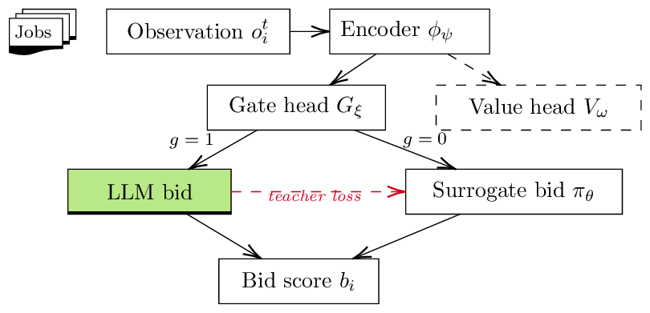

# RLSA: Adaptive LLM Gating for Multi-Agent HPC Scheduling Agents

[](https://github.com/swarm-workflows/RLSA/actions/workflows/tests.yml)
[](https://swarm-workflows.github.io/RLSA/)
[](LICENSE)

Code, data, and reproduction scripts for the paper

> **RLSA: Adaptive LLM Gating for Multi-Agent HPC Scheduling Agents**
> Hongwei Jin, Krishnan Raghavan, Anirban Mandal, Ewa Deelman.
> SC26 Workshops (WORKS), Chicago, IL, November 2026.

LLM-based scheduling agents can reason about heterogeneous resources when they bid
for jobs, but calling an LLM for every bid is slow and expensive. RLSA gives each
bidding agent a small policy that decides, job by job, whether to **pay for an LLM
bid** or **trust a fast learned surrogate**. The policy is trained with PPO on the
downstream scheduling reward (makespan + utilization − LLM cost).

<p align="center"></p>

Main results:

| N=4 auction, 400 jobs, 10 seeds | Makespan (s) | LLM calls / job | Jain |
|---|---:|---:|---:|
| Always-LLM | 7285 | 4.00 | 0.25 |
| Confidence gate (non-RL) | 7562 | 1.38 | 0.822 |
| **RLSA** | **7686** | **2.06** | **0.679** |

RLSA roughly halves LLM calls with no significant makespan difference from
Always-LLM (paired p = 0.072). A simple confidence gate does as well in this
setting, so the paper does **not** claim RL is necessary. On a 17-VM FABRIC
deployment, RLSA's LLM calls grow sub-linearly with the number of bidders.
The [documentation site](https://swarm-workflows.github.io/RLSA/) explains the
method and all results.

## Install

```bash
git clone https://github.com/swarm-workflows/RLSA.git
cd RLSA
pip install -e ".[plot]"        # numpy, torch, gymnasium + plotting
```

A CPU-only PyTorch build is enough for everything except the real-LLM runs
(`pip install torch --index-url https://download.pytorch.org/whl/cpu`).
Optional extras: `.[hf]` (Qwen-2.5 bidders, GPU), `.[fabric]` (FABRIC testbed),
`.[docs]`, `.[dev]`.

## Quick start

```python
from rlsa.envs.gating_env import GatingEnv, GatingEnvConfig
from rlsa.ppo import PPOConfig, RLSATrainer

env_cfg = GatingEnvConfig()
trainer = RLSATrainer(
    env_fn=lambda: GatingEnv(cfg=env_cfg, seed=0),
    cfg=PPOConfig(obs_dim=env_cfg.obs_dim, rollout_length=512, gamma=0.0, gae_lambda=0.0,
                  entropy_coef=0.02, value_coef=0.5),
)
trainer.train(total_timesteps=20_000, pretrain_steps=3_000, log_every=5)
# gate rate on hard jobs climbs toward 100% while easy jobs drop toward 0%
```

A multi-agent auction run (threads + simulated network + mock LLM; a few seconds on CPU):

```bash
python -m experiments.auction.run_auction --algos rlsa,always_llm --ns 4 --seeds 1 \
    --n-jobs 400 --out-dir runs/demo
```

## Reproducing the paper

All raw results behind the paper are in [`results/`](results/) (~5 MB of JSON/CSV
plus the trained checkpoints). Regenerating every figure and table from them takes
about a minute and needs no GPU:

```bash
bash experiments/reproduce/make_figures.sh     # -> figures/*.pdf, tables on stdout
```

Rerunning the experiments themselves:

| Script | What | Hardware |
|---|---|---|
| `experiments/reproduce/single_agent.sh` | training curves, cost sweep, ablation (Table II) | CPU |
| `experiments/reproduce/single_agent_qwen.sh` | real-LLM training and model-size sweep | 1 GPU |
| `experiments/reproduce/auction_mock.sh` | Table I (mock), confidence gate, N scaling, message drop, gamma, long horizon | CPU |
| `experiments/reproduce/auction_qwen.sh` | Table I (Qwen-7B), heterogeneous LLM bidders | 1 GPU (~50 GB) |
| `experiments/reproduce/fabric.sh` | real wide-area deployment, Table III | FABRIC account |

See [`experiments/README.md`](experiments/README.md) for the mapping from each
figure and table to its command and data.

## Repository layout

```
rlsa/                 the library
  rewards.py          composite reward
  gating/             gating policy network, confidence-gate baseline
  bidders/            bidder interface, mock oracle, HuggingFace (Qwen) bidder, prompts
  envs/               gating env (Gymnasium), auction env, threaded distributed auction
  ppo.py              PPO trainer for the gating env
  fabric/             TCP coordinator / agent for real-network deployment
experiments/          experiment drivers, plotting, reproduction scripts
results/              raw results and checkpoints used in the paper
tests/                unit, integration and paper-number regression tests
docs/                 documentation site (MkDocs)
```

## Tests and docs

```bash
pip install -e ".[plot,dev,docs]"
pytest                 # ~1 minute on CPU
mkdocs serve           # http://127.0.0.1:8000
```

## Citation

```bibtex
@inproceedings{jin2026rlsa,
  title     = {{RLSA}: Adaptive {LLM} Gating for Multi-Agent {HPC} Scheduling Agents},
  author    = {Jin, Hongwei and Raghavan, Krishnan and Mandal, Anirban and Deelman, Ewa},
  booktitle = {Proceedings of the SC26 Workshops of the International Conference for
               High Performance Computing, Networking, Storage and Analysis (WORKS)},
  year      = {2026},
  address   = {Chicago, IL, USA},
  publisher = {IEEE}
}
```

## Acknowledgments

This work is supported by the U.S. Department of Energy under grant DE-SC0024387.
