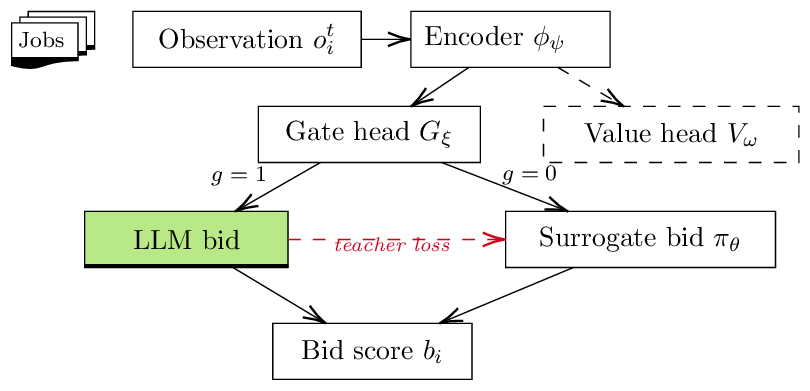

# RLSA: Adaptive LLM Gating for Multi-Agent HPC Scheduling Agents

**Hongwei Jin**, **Krishnan Raghavan** (Argonne National Laboratory),
**Anirban Mandal** (RENCI), **Ewa Deelman** (USC Information Sciences Institute)

*SC26 Workshops (WORKS), Chicago, IL, November 2026*

[Code](https://github.com/swarm-workflows/RLSA){ .md-button .md-button--primary }
[Reproduce the paper](reproduce.md){ .md-button }
[Cite](#citation){ .md-button }

---

## The problem

In decentralized scheduling of scientific workflows, resource agents **bid** for
incoming jobs and a coordinator gives each job to the highest bidder. An LLM can
produce good bids: it weighs a job's requirements against a resource's state more
flexibly than a hand-written cost function. But every LLM call costs latency and
compute, and the cost is paid by every bidder for every job. One-second decisions
repeated across many agents and many jobs do not scale.

## The idea: learn when the LLM is worth it

RLSA gives each agent two ways to bid: call the **LLM**, or use a small neural
**surrogate** that answers almost instantly. A learned **gate** picks one of the two
for every job. The gate is trained with reinforcement learning (PPO) on the
downstream scheduling reward:

\[
R = \lambda_{\mathrm{make}} R_{\mathrm{make}} + \lambda_{\mathrm{util}} R_{\mathrm{util}} + \lambda_{\mathrm{cost}} R_{\mathrm{cost}},
\]

which rewards finishing jobs on time and keeping resources busy, and charges for
every LLM call. Whenever the gate does call the LLM, the returned bid also teaches
the surrogate, so the surrogate keeps getting better at the jobs it is trusted with.

<figure markdown>
  { width="560" }
  <figcaption>Per-agent architecture. A shared encoder feeds a gate, a fast surrogate bidder, and a PPO value head.</figcaption>
</figure>

## What we found

* **Selective computation emerges from reward alone.** In a controlled environment
  the gate learns to call the LLM on almost all hard jobs and almost never on easy
  ones, without being told which jobs are hard.
* **About half the LLM calls at the same makespan.** In a 4-agent asynchronous
  auction RLSA cuts LLM calls from 4.00 to 2.06 per job; makespan is 7686 s vs.
  7285 s for Always-LLM bidding (paired p = 0.072, no significant difference).
* **One knob for the cost/quality trade-off.** The cost weight \(\beta\) moves a
  single policy smoothly between Always-LLM and Always-surrogate behavior.
* **An honest baseline.** A simple non-RL *confidence gate* (frozen surrogate plus
  a predicted-error threshold) matches RLSA in the controlled auction, so we do not
  claim RL is necessary. What RLSA offers is one reward-optimized policy with no
  hand-calibrated threshold, carried unchanged into harder settings.
* **It runs on a real network.** On a 17-VM FABRIC deployment across three US
  sites, LLM calls grow sub-linearly with the number of bidders (0.57 → 2.03 per
  job from 4 to 16 agents, vs. 3.67 → 14.0 for Always-LLM), and coordinator round
  time stays flat at about 33 ms.

See [Results](results.md) for all figures and tables.

## Repository at a glance

| | |
|---|---|
| `rlsa/` | the library: reward, gating policy, bidders, environments, PPO, FABRIC transport |
| `experiments/` | drivers, plotting scripts, and one-command reproduction recipes |
| `results/` | the raw results and trained checkpoints behind every number in the paper |
| `tests/` | unit and integration tests, plus checks that `results/` reproduce the paper's tables |

```bash
pip install -e ".[plot]"
bash experiments/reproduce/make_figures.sh   # every figure and table in ~1 minute, no GPU
```

## Citation

```bibtex
@inproceedings{jin2026rlsa,
  title     = {{RLSA}: Adaptive {LLM} Gating for Multi-Agent {HPC} Scheduling Agents},
  author    = {Jin, Hongwei and Raghavan, Krishnan and Mandal, Anirban and Deelman, Ewa},
  booktitle = {Proceedings of the SC26 Workshops of the International Conference for
               High Performance Computing, Networking, Storage and Analysis (WORKS)},
  year      = {2026},
  address   = {Chicago, IL, USA},
  publisher = {IEEE}
}
```

This work is supported by the U.S. Department of Energy under grant DE-SC0024387.
