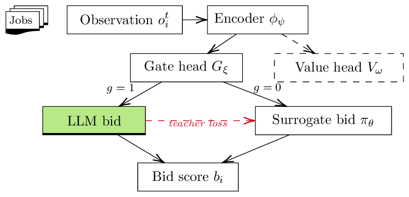

# Method

## Auction model

\(N\) resource agents share a cluster (64 CPUs, 8 GPUs, 256 GB memory, 4 TB storage
in the experiments) and receive a stream of independent jobs. Each job comes with a
resource request and an estimated duration. Every agent emits a bid
\(b_i \in [0, 100]\); the coordinator gives the job to the highest bid, and the
winner holds the job's resources until it finishes. A poor bid can therefore tie up
resources and delay later jobs, which is what makes a better (and more expensive)
bid worth paying for.

Each agent can bid in two ways:

* call an **LLM bidder**, which returns \(b_i^{\mathrm{LLM}}\) after some latency;
* use a **surrogate** network, which returns \(b_i^{\mathrm{surr}}\) almost instantly.

A gate \(g_i \in \{0, 1\}\) selects the source: \(b_i = b_i^{\mathrm{LLM}}\) if
\(g_i = 1\), otherwise \(b_i = b_i^{\mathrm{surr}}\).

## Observation and action

Agent \(i\) decides from its local observation only:

\[
o_i^t = \left(\mathbf{u}_i^t,\; |\mathcal{Q}_i^t|,\; \tilde{\mathbf{u}}_{\mathcal{N}(i)}^t,\; \mathbf{r}_{j^*},\; h_i^t\right),
\]

its CPU/GPU/memory/storage utilization, queue length, a summary of neighbor
utilization, the current job's resource request, and a recent success rate. The
action is the pair \((b_i^t, g_i^t)\).

In code, observations are 20-dimensional vectors (`obs_dim=20`): slots 0-3 hold
utilization, 4-7 the job request, and 8 a noisy difficulty signal.

## Architecture

{ width="520" }

A two-layer MLP encoder \(\phi_\psi\) (hidden size 128, LayerNorm) maps the
observation to a latent \(z\), which feeds three heads
([`GatingPolicy`](api.md#rlsa.gating.policy.GatingPolicy)):

| Head | Output | Role |
|---|---|---|
| gate \(G_\xi(z)\) | \(P(g = 1)\) | Bernoulli during training, thresholded at inference |
| surrogate \(\pi_\theta(z)\) | bid in \([0, 100]\) | the fast bid |
| value \(V_\omega(z)\) | scalar | PPO critic, training only |

Because the gate is thresholded at inference, one trained policy can be run at a
different LLM call rate by moving the threshold (`GatingConfig.gate_threshold`).

## Training objective

Each agent's reward combines three terms
([`composite_reward`](api.md#rlsa.rewards.composite_reward)):

\[
R_i^t = \lambda_{\mathrm{make}} R_{\mathrm{make}}^t + \lambda_{\mathrm{util}} R_{\mathrm{util}}^t + \lambda_{\mathrm{cost}} R_{\mathrm{cost}}^t
\]

* \(R_{\mathrm{make}} = -(\tau^{\mathrm{end}}_k - \tau^{\mathrm{arr}}_k) / \hat d_k\),
  the normalized flow time (−1 when a job finishes on its estimate);
* \(R_{\mathrm{util}} = \mathrm{mean}(\mathbf{u}) - \eta\, \mathrm{std}(\mathbf{u})\),
  utilization minus imbalance;
* \(R_{\mathrm{cost}} = -\beta\, g\, \Delta\tau_{\mathrm{LLM}} / \Delta\tau_{\mathrm{budget}}\),
  zero whenever the surrogate is used.

Defaults: \(\lambda_{\mathrm{make}} = 1\), \(\lambda_{\mathrm{util}} = 0.5\),
\(\lambda_{\mathrm{cost}} = 1\), \(\eta = 0.2\), \(\beta = 1\),
\(\Delta\tau_{\mathrm{budget}} = 2\) s. The cost weight \(\beta\) is the operator
knob.

Two choices matter for the gate:

1. **The gate learns only from the policy gradient.** An auxiliary teacher loss
   (MSE between the surrogate bid and the realized LLM bid, on steps where the LLM
   was called) trains the encoder and surrogate, but the gate's only signal is the
   downstream reward of its decisions.
2. **Bandit credit assignment (\(\gamma = 0\)).** The immediate composite reward is
   attributed to the decision that produced it, which keeps the LLM-cost signal
   sharp. The ablation shows that standard discounted GAE collapses the gate.

Before PPO, the surrogate is warm-started with a short imitation stage in which the
LLM is always called.

```text
for each incoming job j*:
    each feasible agent encodes z_i = phi(o_i)
    sample gate g_i ~ Bernoulli(G(z_i))
    bid b_i = LLM bid if g_i = 1 else surrogate pi(z_i)
    coordinator assigns j* to the highest feasible bid
    observe composite reward R_i
update encoder, gate, surrogate, value with clipped PPO
update surrogate with the auxiliary teacher loss on realized LLM bids
```

## Hyperparameters

| | Gating environment | Distributed auction |
|---|---|---|
| Optimizer | Adam, lr 3e-4 | Adam, lr 3e-4 |
| PPO clip / epochs | 0.2 / 4 epochs, minibatch 64 | 0.2 / 4 epochs, full batch |
| Rollout | 512 steps (256 with a real LLM) | update every 8 rounds per agent (CTDE: pooled over agents) |
| \(\gamma\), GAE \(\lambda\) | 0, 0 | 0 (ablation: 0.95, 0.99 with \(\lambda = 0.95\)) |
| Value / entropy / teacher coef. | 0.5 / 0.02 / 1.0 | 0.5 / 0.02 / 1.0 |
| Gradient clip | 0.5 | 0.5 |
| Imitation pretraining | 3000 steps (2000 for sweeps, 1000 real LLM), 100 epochs | LLM on each agent's first `pretrain_steps` bids (80 of 400 jobs), then 30 epochs |
| Stale-bid penalty | - | 0.05 |

## Environments

**Controlled gating environment**
([`GatingEnv`](api.md#rlsa.envs.gating_env.GatingEnv)). One step is one job. A
hidden difficulty (30% hard) controls how noisy the surrogate is: its error has
standard deviation 2 bid units on easy jobs and 55 on hard ones. A bid error \(E\)
adds \(800\,(E/100)^2\) seconds to a 60-second job. The built-in LLM is a perfect
oracle with about 2 s of (reported) latency, or a real model via
`GatingEnvConfig.bidder`. The optimal policy calls the LLM on hard jobs only.

**Threaded asynchronous auction**
([`run_distributed`](api.md#rlsa.envs.distributed.run_distributed)). Each agent
runs in its own thread. Each job reaches the agents through a simulated network
(Gaussian delay, default 2 ± 0.5 ms, optional drop). The coordinator waits for bids
up to a deadline (50 ms with the mock bidder, 200 ms with Qwen). Late bids are
flagged stale and lightly penalized but still counted. The job stream is fixed by
the seed, so seeds are paired across algorithms. Agents share one policy (CTDE) or
own one each (DTDE).

**Real network** ([`rlsa.fabric`](fabric.md)). The same auction, with the
coordinator and agents as separate processes on separate machines talking over TCP.

## Baselines

| Name | Bid |
|---|---|
| `random` | uniform in [0, 100] |
| `capacity` / `always_surrogate` | resource heuristic \(100\,(0.4 f_{cpu} + 0.1 f_{gpu} + 0.3 f_{ram} + 0.2 f_{disk})\) of free capacity |
| `always_llm` | the LLM on every job |
| `oracle` | privileged: the LLM exactly on hard jobs, the true bid otherwise |
| `confidence_gate` | frozen RLSA surrogate; call the LLM when a residual head predicts surrogate error > \(\tau\) |
| `rlsa` | the learned gate |
