# Results

All numbers below come from the files in `results/`; every figure on this page is
regenerated by `bash experiments/reproduce/make_figures.sh` (see
[Reproducing the paper](reproduce.md)).

## 1. RLSA learns selective LLM use

In the controlled gating environment, hard jobs are those where the surrogate is
unreliable. Without being told which jobs are hard, the gate learns to call the LLM
on nearly all hard jobs and almost never on easy ones (mock oracle bidder, 5 seeds).

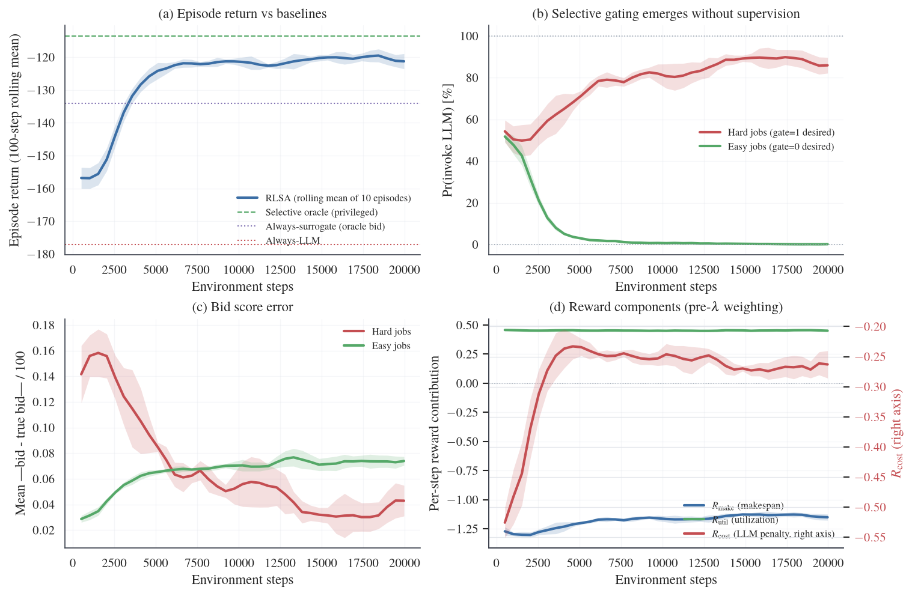

With a real **Qwen-2.5-3B** bidder (3 seeds), the hard-job call rate stays near 80%
while the easy-job rate falls from about 52% to 17%: the separation survives a noisy
real teacher. Here the LLM answers much faster than the 2 s budget assumed by the
cost term, so \(R_{\mathrm{cost}}\) is about 100× smaller than \(R_{\mathrm{make}}\)
(panel d, right axis) and the behavior is driven mainly by makespan.

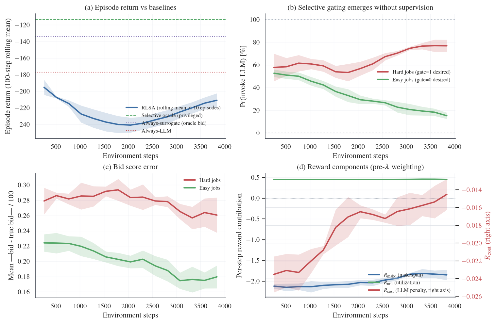

Bigger is not better for the bidder. Across Qwen-2.5 3B, 7B and 14B, the cleanest
easy/hard split comes from 3B and the least consistent from 7B. What the gate needs
is a *consistent* teacher. We read this as a hypothesis from one model family, not
a scaling law.

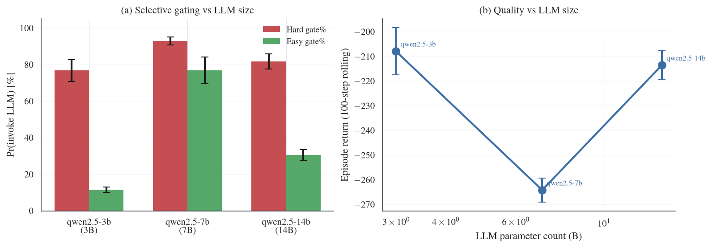

### Ablation (Table II)

Mean ± std over 3 seeds in the gating environment.

| Variant | Overall R | Easy gate % | Hard gate % |
|---|---:|---:|---:|
| **Full RLSA** | −1.165 ± 0.014 | 0.0 ± 0.0 | 95.6 ± 2.2 |
| − imitation pretraining | −1.199 ± 0.009 | 0.0 ± 0.0 | 96.9 ± 1.6 |
| − auxiliary teacher loss | −1.301 ± 0.051 | 0.0 ± 0.0 | 97.4 ± 1.5 |
| − bandit GAE (\(\gamma = 0.99\)) | −1.557 ± 0.032 | 0.0 ± 0.0 | 0.0 ± 0.0 |

Bandit credit assignment is the load-bearing ingredient: with discounted GAE the
policy collapses to never calling the LLM.

## 2. Adaptive gating in a multi-agent auction (Table I)

Threaded asynchronous auction, \(N = 4\), deterministic tiebreak. Mock: 400 jobs,
10 seeds. Real Qwen-2.5-7B: 200 jobs, 5 seeds.

| Strategy | Makespan (mock) | LLM/job (mock) | Jain (mock) | Makespan (Qwen-7B) | LLM/job (Qwen-7B) | Jain (Qwen-7B) |
|---|---:|---:|---:|---:|---:|---:|
| Random | 14663 | 0.00 | 0.99 | | | |
| Capacity | 22017 | 0.00 | 0.25 | | | |
| Always surrogate | 22017 | 0.00 | 0.25 | | | |
| Confidence gate (τ = 10) | 7562 | 1.38 | 0.822 | | | |
| Always-LLM | 7285 | 4.00 | 0.25 | 6222 | 4.00 | 0.25 |
| Oracle (privileged) | 7285 | 1.22 | 0.25 | 4818 | 1.36 | 0.25 |
| **RLSA** | **7686** | **2.06** | **0.679** | **6120** | **3.44** | **0.391** |

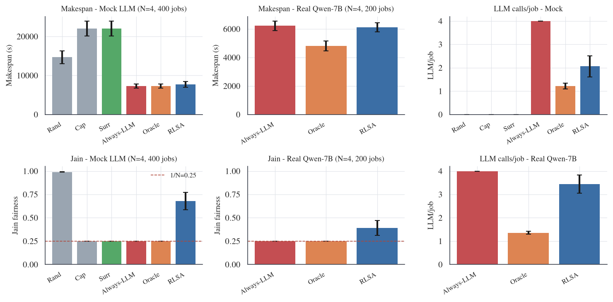

* RLSA halves LLM calls (4.00 → 2.06) with no statistically significant makespan
  difference from Always-LLM (paired t-test p = 0.072 over 10 seeds). This is an
  absence of evidence for a difference, not a proof of equivalence.
* The **non-RL confidence gate** matches or beats RLSA on all three metrics in
  this setting (paired vs. RLSA: makespan p = 0.45, LLM/job p = 0.13, Jain
  p = 0.10). The paper therefore does not claim RL is necessary for adaptive gating.
* With a real Qwen-7B bidder the savings are smaller (4.00 → 3.44) because the
  real bidder is noisier and deadlines are tighter.
* Jain fairness over per-agent wins is a diagnostic for "all work collapses onto one
  agent". With a deterministic tiebreak, any fixed-bid strategy sits at 1/N.

## 3. Cost–quality control

The cost weight \(\beta\) moves one policy smoothly from Always-LLM toward
Always-surrogate behavior. The gate stops calling the LLM on easy jobs long before
it gives up on hard ones.

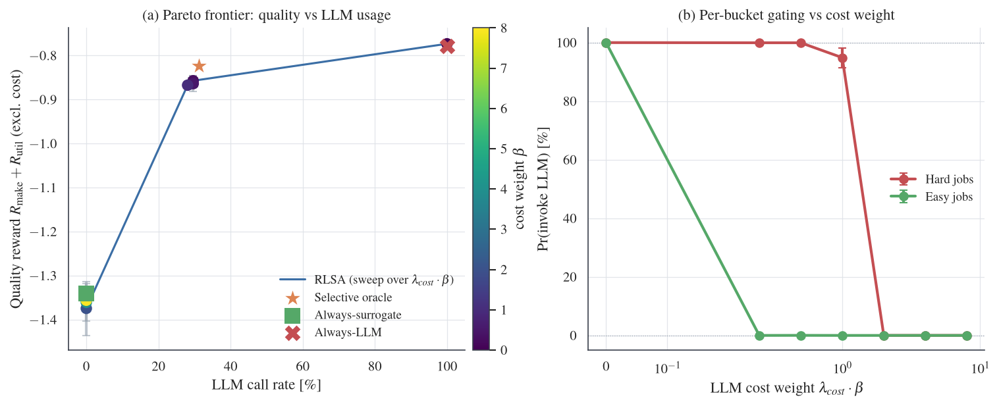

The same trade-off shows up over a longer horizon. With \(N = 4\) and 800 jobs, RLSA
uses 1.03 LLM calls per job (−75% vs. 4.00) at a makespan of 14583 s vs. 13662 s for
Always-LLM.

## 4. Scaling the number of bidders

Throughput is flat from \(N = 1\) to \(16\) because the shared cluster, not the
number of bidders, is the bottleneck. RLSA keeps per-agent diversity instead of
collapsing to one winner (3 seeds).

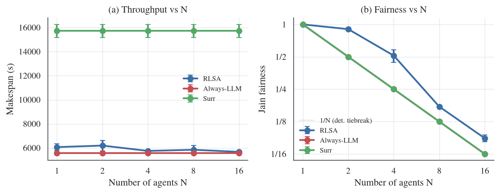

## 5. Robustness to message loss

Message-drop probability in {0, 5, 10, 20}%, RLSA retrained at each level
(3 seeds). Makespan stays within about 5% of the no-drop value. LLM cost falls from
3.34 to 1.55 calls per job, and Jain rises from 0.43 to 0.86, mostly because random
drops diversify who wins. A policy trained at 0% drop and **frozen** keeps most of
the benefit (2.45 → 1.60 LLM calls per job).

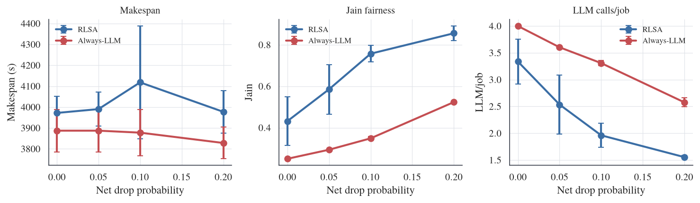

## 6. Discount factor in a coupled environment

The auction is temporally coupled: an accepted job locks resources for later rounds.
Even so, \(\gamma = 0\) gives the lowest LLM cost (2.02 per job) and the highest
fairness (0.687). \(\gamma = 0.95\) and \(0.99\) buy about 3.5% makespan at 2.89 and
3.35 LLM calls per job (10 seeds).

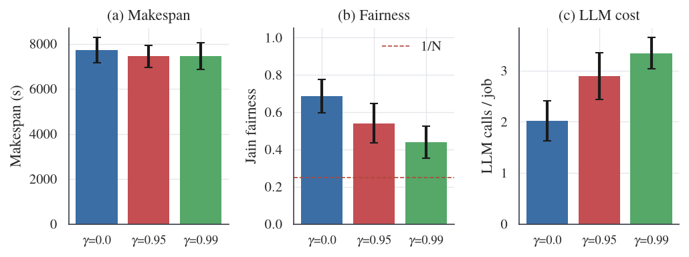

## 7. Heterogeneous LLM bidders

The four agents use four different bidders: Qwen-2.5 3B, 7B and 14B plus a mock
oracle, all loaded on one A100 (100 jobs, 3 repeats). Compared with Always-LLM,
RLSA spreads work more evenly (Jain 0.584 → 0.836) and makes 56% fewer LLM calls,
with makespan within 3%. With a tight deadline, the bidder that limits the fleet is
the one with the least consistent tail latency, not the smallest one.

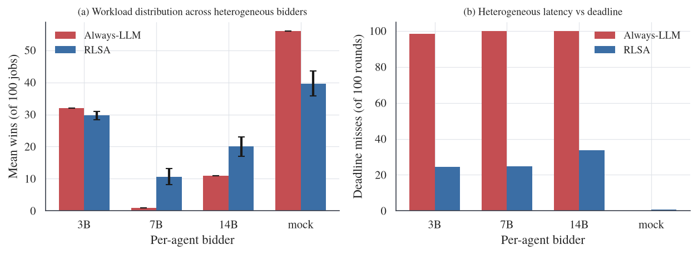

## 8. Real wide-area deployment on FABRIC

One coordinator and sixteen agents on separate VMs at three FABRIC sites, talking
over real TCP (inter-site RTT about 24-27 ms). Agents run the frozen headline policy
with the mock bidder, so this tests whether the auction **composes and scales over
a real network**. It does not re-validate real LLM latency.

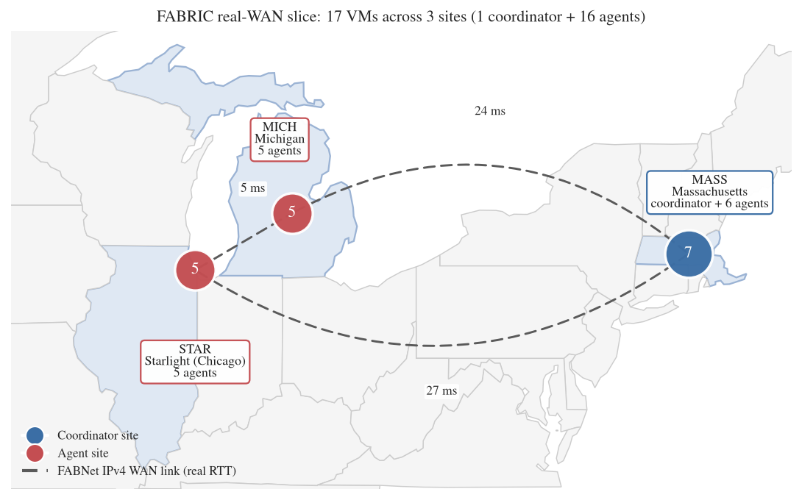

**Real packet loss.** With `tc netem` loss in {0, 5, 10, 20}% at \(N = 4\), RLSA's
makespan stays within about 1%, Jain stays near 0.99, and LLM cost stays near 0.6
calls per job (7× below Always-LLM), while p95 RTT climbs from 32 ms to 282 ms.

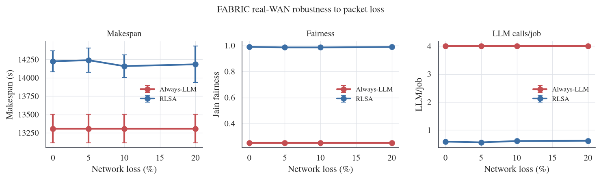

**Scaling to sixteen nodes (Table III).** Mean over 3 seeds, no injected loss.

| N | Algorithm | Jain | LLM/job | Round (ms) |
|---:|---|---:|---:|---:|
| 4 | RLSA | 0.993 | 0.57 | 32.2 |
| 8 | RLSA | 0.937 | 1.18 | 33.0 |
| 16 | RLSA | 0.689 | 2.03 | 33.4 |
| 4 | Always-LLM | 0.250 | 3.67 | 34.2 |
| 8 | Always-LLM | 0.125 | 8.00 | 34.9 |
| 16 | Always-LLM | 0.062 | 14.00 | 36.4 |

RLSA's LLM cost grows sub-linearly with the number of agents while Always-LLM's
grows linearly. Coordinator round time stays flat because the job is broadcast to
all agents concurrently.

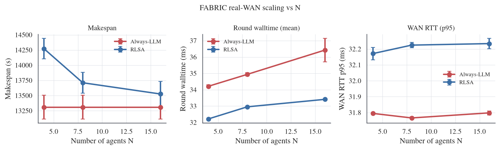

## Limitations

* The wide-area study uses the mock bidder; real-LLM gating quality is tested only
  at smaller scale in the threaded simulator.
* Several supporting findings (model sweep, heterogeneous bidders, N scaling, drop
  sweeps) use 3-5 seeds and are trend evidence.
* Jobs are synthetic and independent; dependency-aware (DAG) workflow scheduling is
  the natural next step.
